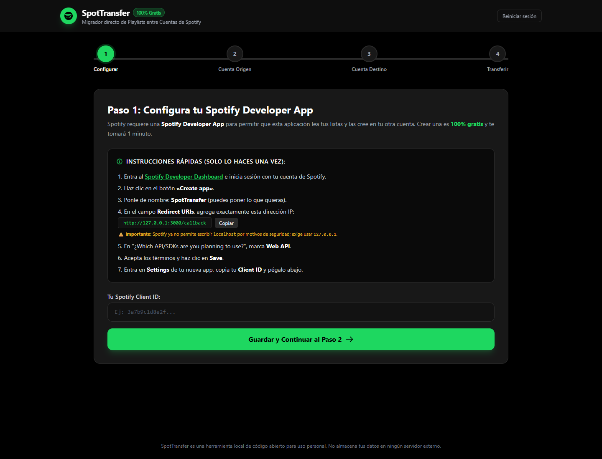
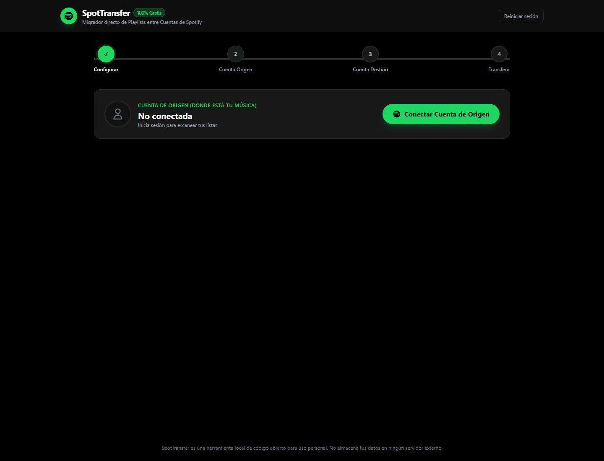
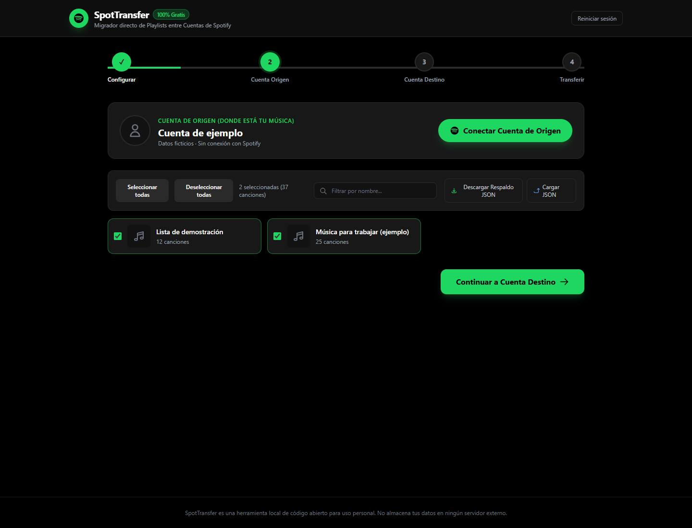
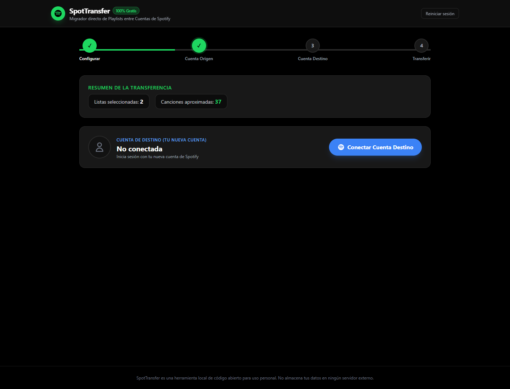

# SpotifyTransferly

Aplicación local en español para trasladar playlists y canciones guardadas entre dos cuentas de Spotify. Está hecha con JavaScript, HTML y CSS, con un servidor HTTP de Node.js sin dependencias de ejecución.

## Capturas

Las capturas se tomaron en un navegador aislado. No contienen cuentas, correos, claves, tokens ni bibliotecas reales. Las listas de demostración son ficticias.






## Ejecutar

Requiere Node.js 22 o superior y acceso a Internet. No necesita `npm install`.

```sh
npm start
```

Abre `http://127.0.0.1:3000`. En Windows también puedes ejecutar `iniciar.bat` o `start.bat`. Para detener el servidor, presiona Ctrl+C en la terminal.

El servidor escucha exclusivamente en `127.0.0.1`. No debe desplegarse como servicio público. `OPEN_BROWSER=0` desactiva la apertura automática del navegador. Aunque el servidor admite `PORT`, el cliente tiene configurado el callback del puerto 3000: para cambiar de puerto debes actualizar también `state.redirectUri` en `public/app.js` y el registro de tu app de Spotify.

## Configuración y uso

1. Crea tu propia aplicación en el [Spotify Developer Dashboard](https://developer.spotify.com/dashboard) y registra exactamente `http://127.0.0.1:3000/callback` como redirect URI. Usa Web API.
2. Introduce tu propio Client ID en la interfaz. No necesita Client Secret. No publiques tu configuración personal en el repositorio.
3. Conecta la cuenta de origen y selecciona las listas que quieras trasladar. Puedes buscar, seleccionar todas o exportar un respaldo JSON.
4. Conecta la cuenta de destino. Comprueba que sea la cuenta correcta; Spotify puede recordar la sesión anterior.
5. Elige la privacidad de las listas nuevas y si quieres guardar los favoritos en la biblioteca. Inicia la transferencia y revisa el registro y los enlaces finales.

Los permisos y las restricciones dependen de Spotify y del modo de tu aplicación. Ante un 403, revisa el acceso de ambas cuentas en tu Developer Dashboard. La aplicación no impone un cupo propio, pero sí está sujeta a disponibilidad, permisos y límites de Spotify.

## Cómo funciona

```text
Navegador → autorización OAuth PKCE en Spotify
          → POST /api/token al servidor local
Servidor  → intercambio del código con accounts.spotify.com
Navegador → llamadas autenticadas a api.spotify.com
          → selección, lectura paginada y escritura por lotes
```

- **Autenticación:** genera un verificador aleatorio, su desafío SHA-256 y un `state` para validar el retorno OAuth. El servidor intercambia el código con Spotify; nunca requiere la contraseña ni un Client Secret.
- **Origen:** consulta el perfil, las playlists y el total de favoritos. Conserva selección y datos de sesión en el almacenamiento local del navegador.
- **Playlists propias:** lee las pistas por páginas, omite archivos locales y crea una lista nueva en el destino. Añade canciones en lotes de hasta 100.
- **Listas de terceros:** las guarda/sigue en la biblioteca destino; no crea una copia independiente. Si Spotify rechaza la lectura de pistas con 403, también intenta guardarlas directamente.
- **Favoritos:** puede guardarlos con corazón en lotes de 40 y también crea la playlist “Mis Me Gusta (Transferidos)”.
- **Límites:** ante HTTP 429 espera según `Retry-After`. Algunos endpoints tienen alternativas de compatibilidad. Los permisos efectivos los decide Spotify.
- **Resultados:** muestra progreso, mensajes y enlaces a las listas creadas o guardadas. Revisa el registro: una pantalla final no garantiza que cada operación haya tenido éxito.

## Archivos

| Archivo | Responsabilidad |
| --- | --- |
| `server.js` | Archivos estáticos, callback SPA y proxy de intercambio OAuth |
| `public/app.js` | PKCE, estado, navegación, API de Spotify, respaldos y transferencia |
| `public/index.html` | Configuración, origen, destino, progreso y resultados |
| `public/style.css` | Detalles visuales y animaciones |
| `iniciar.bat`, `start.bat` | Localizar Node.js y arrancar en Windows |
| `docs/screenshots/` | Capturas revisadas con datos ficticios |

## Privacidad y seguridad

- El código versionado no necesita credenciales. `.gitignore` excluye `.env`, claves, certificados, tokens, registros y respaldos exportados habituales.
- El proxy no imprime respuestas OAuth, limita el tamaño de la petición y rechaza hosts/orígenes ajenos al servidor local. El token Bearer solo se envía al dominio de la API de Spotify.
- Los tokens de sesión se guardan en **sessionStorage** (se destruyen automáticamente al cerrar la pestaña o ventana). Usa **Reiniciar sesión** para borrar todos los datos locales; esto no revoca por sí solo la autorización en Spotify.
- El código OAuth se retira de la URL al procesarlo. El verificador PKCE se elimina después de recuperarlo. Los tokens se renuevan automáticamente mediante el `refresh_token` si caducan durante una transferencia prolongada.
- Los respaldos JSON contienen nombres, descripciones e identificadores de listas y canciones. Son datos personales aunque no incluyan tokens. Consérvalos fuera de Git.
- Hay conexiones externas a Spotify y al CDN de Tailwind CSS. La interfaz necesita Internet; “local” describe dónde se ejecuta la aplicación, no ausencia de tráfico externo.
- Los nombres externos se escapan antes de insertarlos en plantillas HTML. No cargues respaldos de procedencia desconocida.

## Limitaciones conocidas

La transferencia no es transaccional ni tiene reanudación: repetirla puede duplicar listas. Los reintentos de escritura y alternativas de endpoints también pueden duplicar operaciones si Spotify procesa una solicitud antes de fallar la respuesta. No se copian archivos de audio, portadas ni todos los metadatos.

La importación JSON carga las listas y transfiere directamente sus pistas guardadas a la cuenta de destino sin requerir conexión a la cuenta de origen. Si se repite una transferencia, pueden crearse listas duplicadas en la cuenta destino. No se copian archivos de audio ni portadas personalizadas.

## Verificación

Se comprobaron sintaxis de ambos archivos JavaScript, arranque local, navegación de configuración a selección y destino, escape de nombres HTML, restricciones de host/origen y revisión de secretos de los archivos preparados. Las capturas no requieren iniciar sesión.

No se ejecutó una transferencia real: requiere autorización de dos cuentas y modifica la biblioteca destino. Las restricciones y cambios de la API de Spotify pueden requerir ajustes futuros.
